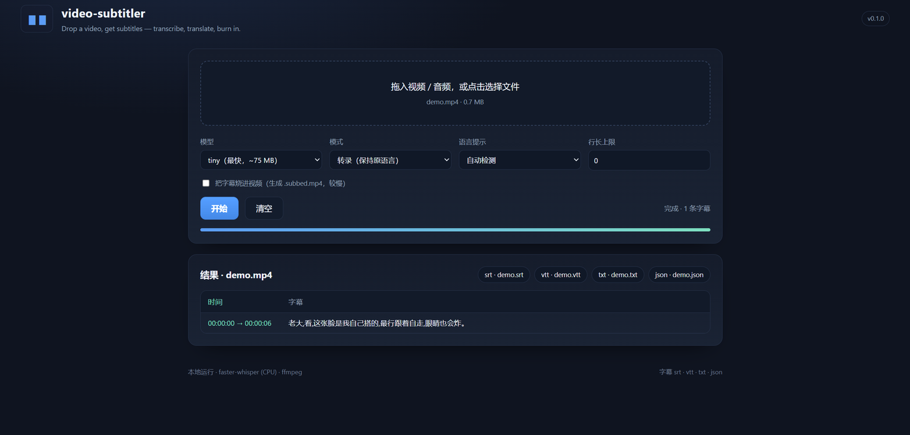

# video-subtitler

> Drop a video, get subtitles. Transcribe, translate, burn in — all on your own machine.

A small, dependency-light alternative to desktop transcription apps: one CLI,
one local web page, no accounts, no uploads to anyone's server.
Built on [faster-whisper](https://github.com/SYSTRAN/faster-whisper) (CPU int8) and ffmpeg.

`video-subtitler` 是一个本地字幕工具：丢一个视频进去，几秒钟拿到字幕文件；
可以直接用 Whisper 离线翻译成英文，也可以接任意 OpenAI 兼容接口翻译成别的语言。

---

## Features

| | |
|---|---|
| **Any input** | mp4 / mkv / mov / webm / mp3 / wav / m4a — audio is extracted with ffmpeg |
| **Transcript** | timed segments with `.srt` `.vtt` `.txt` `.json` output |
| **Offline translation → English** | Whisper's built-in `translate` task, zero network calls |
| **Any language → any language** | optional OpenAI-compatible chat endpoint (OpenAI / DeepSeek / local vLLM …) |
| **Bilingual subtitles** | on the LLM path each line is translated 1:1 → `clip.bilingual.srt` |
| **Burn-in** | hard-coded subtitles with ffmpeg, ready to post |
| **Line control** | split over-long lines on punctuation (`--max-chars`) |
| **Local web UI** | drag & drop, live progress, subtitle table, one-click download |
| **CPU only** | tiny model runs in real time on a laptop, no GPU needed |

## Quick start

```bash
# 1. dependencies (Python 3.10+ and ffmpeg on PATH)
pip install -r requirements.txt

# 2. subtitles, keeping the spoken language
python subtitler.py clip.mp4
#   -> clip.srt  clip.vtt  clip.txt  clip.json

# 3. offline translation to English
python subtitler.py clip.mp4 --task translate
#   -> clip.srt (English) + clip.zh.srt (the original track)

# 4. translate into Chinese through an OpenAI-compatible endpoint
set OPENAI_API_KEY=sk-...
python subtitler.py clip.mp4 --to zh --llm-model gpt-4o-mini
#   -> clip.zh.srt + clip.bilingual.srt (source and translation per line)

# 5. burn the subtitles into the picture
python subtitler.py clip.mp4 --burn
#   -> clip.subbed.mp4
```

Web UI:

```bash
python server.py            # then open http://127.0.0.1:8770
```

On Windows you can also double-click `run.bat` (CLI) or `run-web.bat` (UI).

## Web UI



Drag a file onto the page, pick a model, hit 开始 — the page polls the job and
shows the timestamped lines plus one download button per output format.
Uploads are written to `work/uploads/<job>/` and deleted when the job ends.

## CLI reference

```
python subtitler.py MEDIA [MEDIA ...] [options]

  -o, --outdir DIR        output folder (default: next to the input file)
  -m, --model NAME        tiny | base | small | medium | large-v3   (default: tiny)
  -l, --language CODE     spoken language hint, e.g. zh, en          (default: auto)
      --task TASK         transcribe | translate (offline -> English)
      --to LANG           translate into LANG via an OpenAI-compatible endpoint
      --llm-model NAME    override the chat model
      --llm-base URL      override the chat base URL
      --max-chars N       split subtitle lines longer than N characters
      --burn              also write MEDIA.subbed.mp4 with burned-in subtitles
  -q, --quiet             no progress output
```

Environment variables for the optional LLM translation:
`OPENAI_API_KEY` / `OPENAI_BASE_URL` / `OPENAI_MODEL`
(or `DEEPSEEK_API_KEY` / `DEEPSEEK_BASE_URL` / `DEEPSEEK_MODEL`).

## How it works

```
video ──ffmpeg──> 16 kHz mono wav ──faster-whisper──> timed segments
                                                       │
                        ┌──────────────────────────────┼───────────────────────────┐
                        ▼                              ▼                           ▼
                    .srt/.vtt/.txt/.json        translate (offline or LLM)   ffmpeg burn-in ──> .subbed.mp4
```

- `subs_core.py` — segmentation, timecode maths, SRT/VTT/TXT/JSON writers,
  line splitting, merging, LLM translation and the ffmpeg helpers.
- `subtitler.py` — the command line front end.
- `server.py` + `static/` — the local web UI (standard library `http.server`,
  vanilla JS, no build step).

## Demo

`demo/demo.subbed.mp4` is the result of running the tool on a 7 second
clip with the `tiny` model and `--burn`; `demo/demo.srt` is the same
run's subtitle file. Expect better text from `small` or `medium`.

## Tests

```bash
python -m unittest discover -s tests
```

25 tests, no model download needed:

- `tests/test_core.py` (17) - timecodes, SRT/VTT/JSON round-trips,
  punctuation-aware line splitting (CJK and English), segment merging,
  bilingual output, segment re-timing.
- `tests/test_http.py` (8) - the web API with a stubbed pipeline: upload, job
  lifecycle, download, file-name sanitising, 404s.

## Limits worth knowing

- Model quality follows the model size: `tiny` is fast but will mishear accents;
  use `small`/`medium` for anything you intend to publish.
- The offline path only translates **into English** — that is a Whisper property,
  not a shortcut. Other targets need the LLM path.
- The offline `--task translate` mode runs Whisper twice (transcribe, then
  translate) and the two passes cut the audio at different points. Rather than
  fake a line-by-line pairing it writes the English `.srt` plus the original
  track as `clip.<lang>.srt`; bilingual files come from the LLM path, where
  every line is translated 1:1.
- Translation is line-by-line, so cross-sentence context is limited to the batch
  that goes out with each request.
- Burn-in re-encodes the video (x264, CRF 20); audio is stream-copied.

## License

MIT. Whisper models are downloaded by faster-whisper under their own licences.
